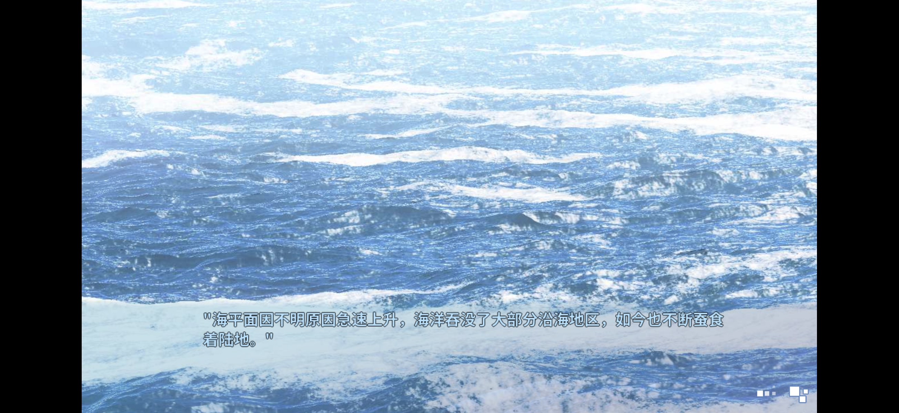
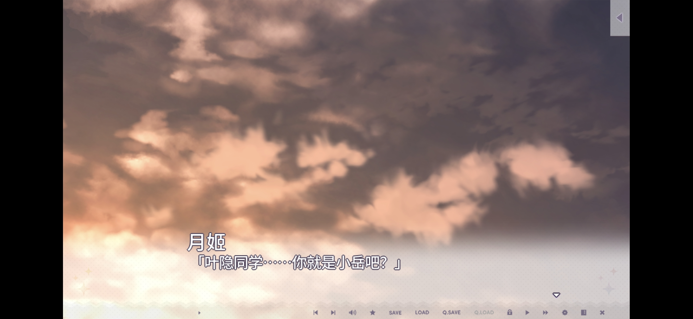
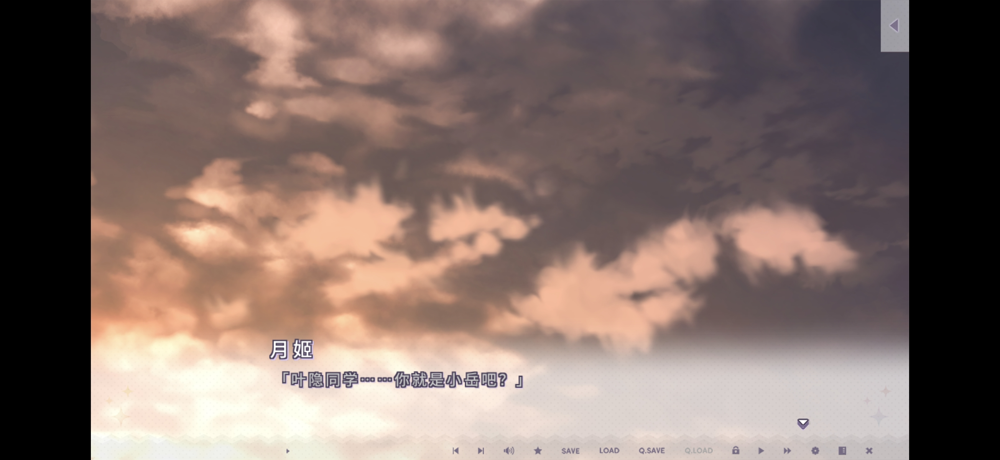
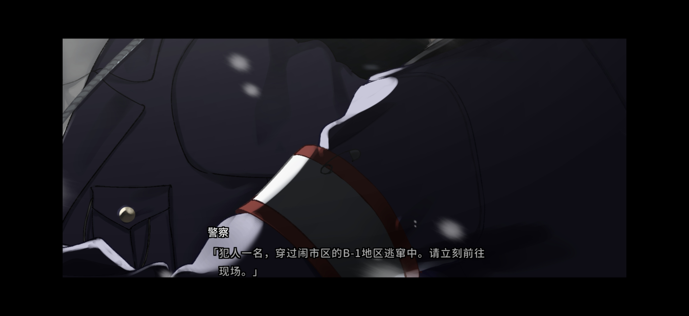

# Android文本修复历史对比图

9张原图按拍摄时间分组：1–3修复后三样本，4–6修复前三样本，7–9官方内核三样本。每组内按样本顺序对应；原始文件名和图像字节不变。

修复后图片来自历史R8集成版本 `e0937e02fa9b2422940ecef73773e55ab2ca64c9`，用于字号、字距、换行和行距对比。原图滤镜监控叠层不表示当前修复PR提供超分功能。当前PR已按维护者要求移出舞台接口、GLES3偏好及滤镜回调，并适配最新上游；新候选尚无新的游戏实测。

用户确认的历史结果包括文本、普通后台、系统音量和游戏系统语音；静态图片不能证明后台/音频行为，也不构成仍未解决的菜单选项/YES-NO问题验收。

## 时间戳索引

|序号|样本|状态|原始文件|
|---|---|---|---|
|1|1|修复后|[Screenshot_2026-10-08-22-45-57-943_com.tyranor.next.jpg](Screenshot_2026-10-08-22-45-57-943_com.tyranor.next.jpg)|
|2|2|修复后|[Screenshot_2026-10-08-22-47-55-742_com.tyranor.next.jpg](Screenshot_2026-10-08-22-47-55-742_com.tyranor.next.jpg)|
|3|3|修复后|[Screenshot_2026-10-08-22-48-25-882_com.tyranor.next.jpg](Screenshot_2026-10-08-22-48-25-882_com.tyranor.next.jpg)|
|4|1|修复前|[Screenshot_2026-10-08-22-49-41-101_com.tyranor.next.jpg](Screenshot_2026-10-08-22-49-41-101_com.tyranor.next.jpg)|
|5|2|修复前|[Screenshot_2026-10-08-22-50-35-648_com.tyranor.next.jpg](Screenshot_2026-10-08-22-50-35-648_com.tyranor.next.jpg)|
|6|3|修复前|[Screenshot_2026-10-08-22-51-14-527_com.tyranor.next.jpg](Screenshot_2026-10-08-22-51-14-527_com.tyranor.next.jpg)|
|7|1|官方内核|[Screenshot_2026-10-08-22-51-49-189_com.tyranor.next.jpg](Screenshot_2026-10-08-22-51-49-189_com.tyranor.next.jpg)|
|8|2|官方内核|[Screenshot_2026-10-08-22-52-14-661_com.tyranor.next.jpg](Screenshot_2026-10-08-22-52-14-661_com.tyranor.next.jpg)|
|9|3|官方内核|[Screenshot_2026-10-08-22-52-40-646_com.tyranor.next.jpg](Screenshot_2026-10-08-22-52-40-646_com.tyranor.next.jpg)|

## 按样本比较

|样本|修复后|修复前|官方内核|
|---|---|---|---|
|1||||
|2||||
|3||||

附件仅为提交者提供的实机对比图，不作为测试夹具，不包含游戏包、脚本、官方引擎二进制或密钥。
